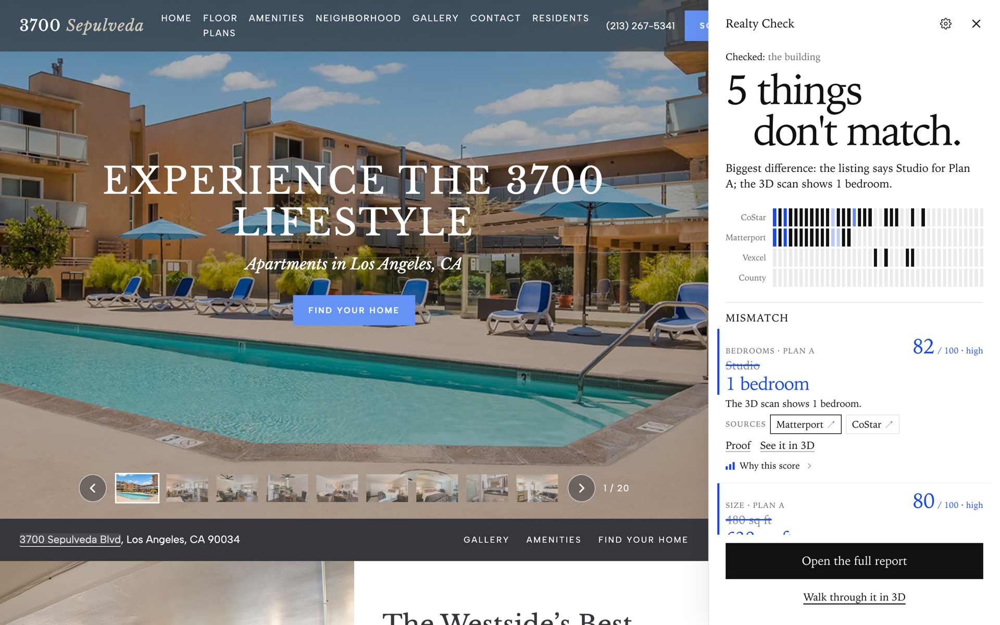
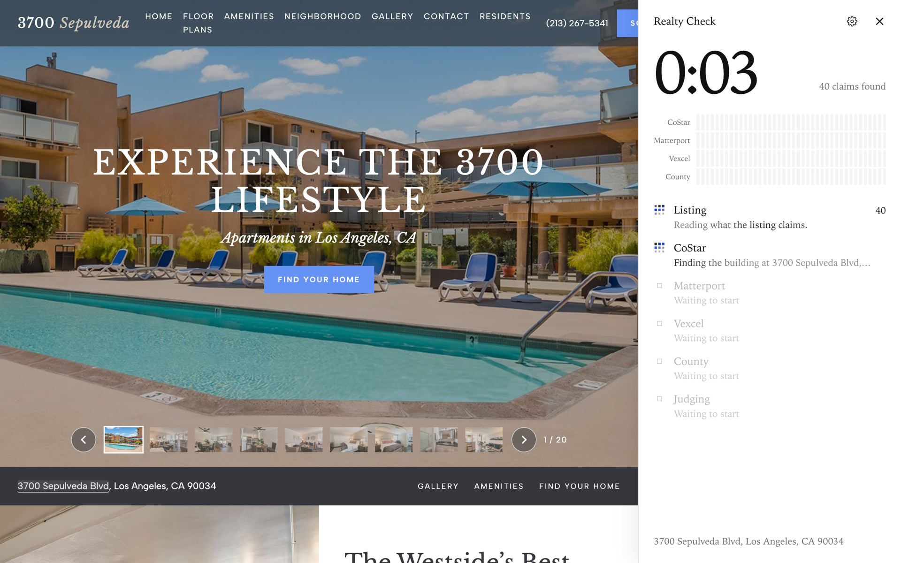
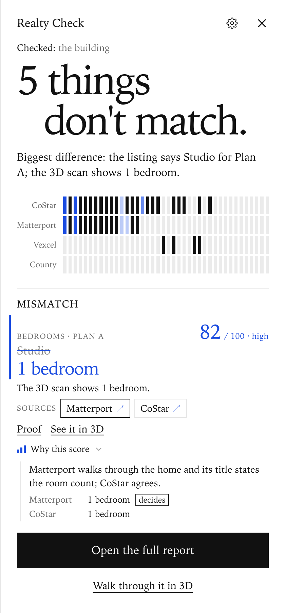
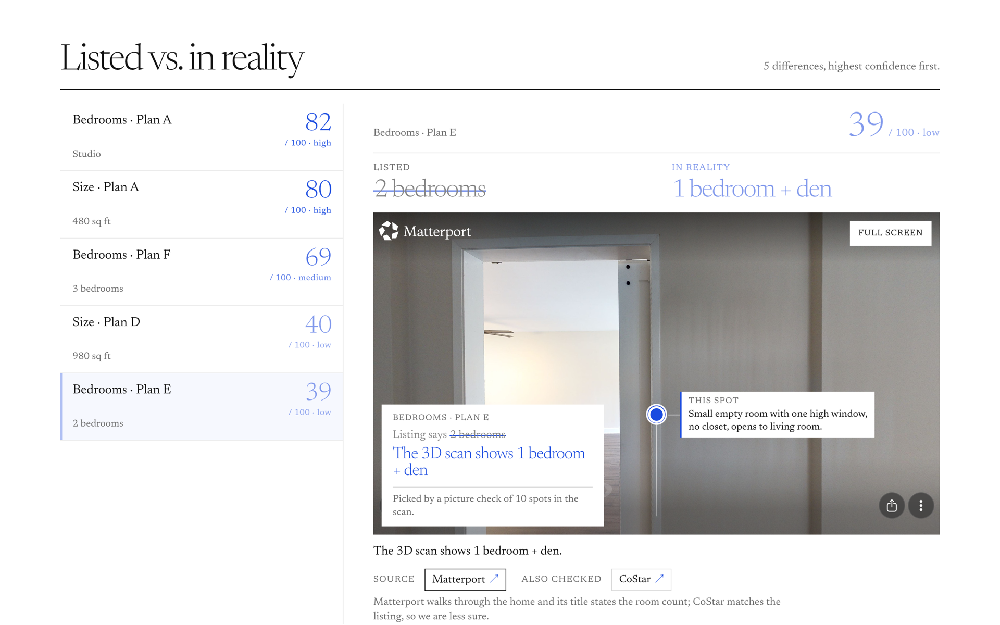
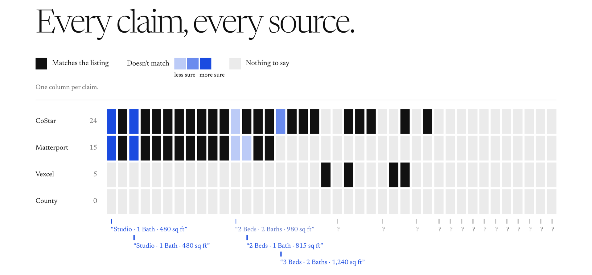
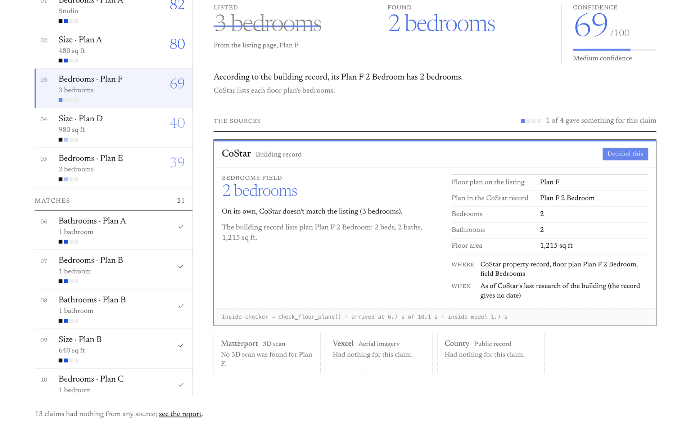
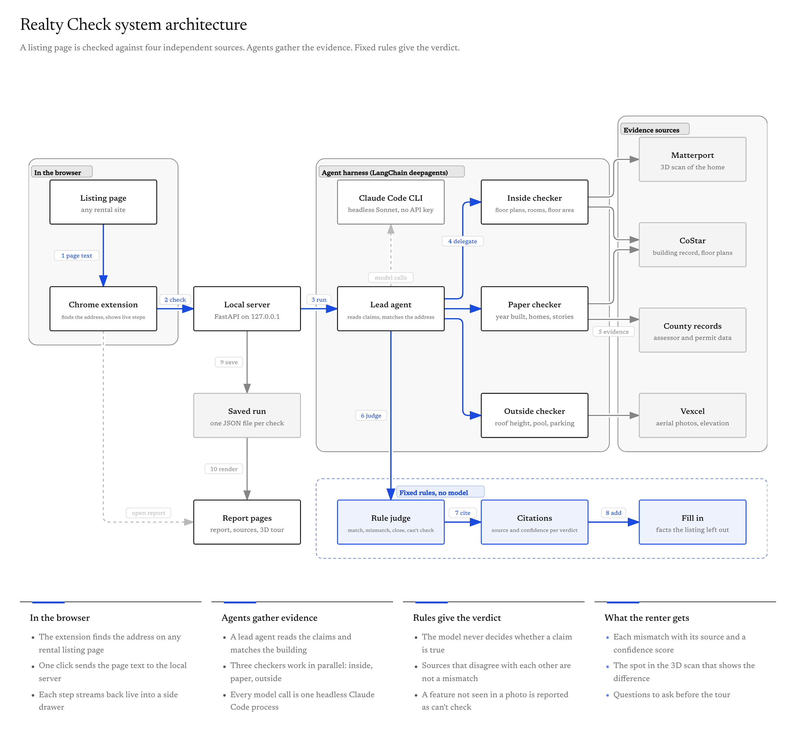

<h1 align="center">Realty Check</h1>

<p align="center">
  <strong>A fact check for rental listings, run from the listing page itself.</strong>
</p>

<p align="center">
  Built at HackPrinceton, Fall 2026
</p>

<p align="center">
  
</p>

## What we built

Realty Check is a Chrome extension with a small local server behind it. Open a rental listing on any site, click the address, and it reads every claim the page makes: bedrooms, square footage, year built, number of homes, amenities. Each claim is then checked against four sources that the landlord did not write, namely the CoStar building record, a Matterport 3D scan of the unit, Vexcel aerial imagery and county records.

The answer comes back in a drawer beside the listing in about a minute. It says how many things do not match, shows the evidence for each one, and gives a confidence score. A fuller report opens in a new tab, with the 3D scan parked on the exact spot that settles the claim.

One design choice runs through all of it. The model gathers evidence, but it never decides whether a claim is true. That call is made by fixed rules that anyone can read.

## Table of contents

- [The problem](#the-problem)
- [How it works](#how-it-works)
- [What you see](#what-you-see)
- [Demo video](#demo-video)
- [System architecture](#system-architecture)
- [Where the evidence comes from](#where-the-evidence-comes-from)
- [How a verdict is reached](#how-a-verdict-is-reached)
- [Getting started](#getting-started)
- [Repository layout](#repository-layout)
- [Tests](#tests)
- [Known limits](#known-limits)
- [Hackathon tracks](#hackathon-tracks)
- [Further reading](#further-reading)

## The problem

A rental listing is written by the person who wants to rent the place out. Nobody checks it. A studio can be advertised as a one bedroom, a den can be counted as a second bedroom, and 480 square feet can turn out to be a generous rounding.

Most renters catch these things on a tour. Plenty of renters never get one. Someone relocating for a job, a medical resident who learns their city on Match Day, a family on military orders: they sign from another state, on the strength of photos and a paragraph of text.

The data needed to check a listing already exists. Building records list every floor plan. 3D scans show the rooms as they are. Aerial photos show the roof and the pool. County records hold the year built and the unit count. What has been missing is something that puts those sources next to the listing, claim by claim, at the moment a renter is reading it.

## How it works

1. The extension finds the street address on the page and marks it.
2. Clicking the address sends the page text to a server running on the same machine.
3. A lead agent reads the claims and matches the address to a building.
4. Three checkers run in parallel. One looks inside the home (floor plans and the 3D scan), one looks at the paper trail (county and building records), and one looks from above (aerial photos and roof height).
5. A rule judge compares every claim with the evidence and gives it one of four verdicts.
6. Each verdict is tied to the sources behind it, and each mismatch gets a confidence score.
7. The result streams into the drawer as it happens, and the full report is saved for later.

Each check runs when you click. Lookups are cached afterwards, so checking the same listing again is faster.

## What you see

While the check runs, the drawer shows each source as it reports in.

<p align="center">
  
</p>

Every mismatch carries a confidence score from 0 to 100, and one click explains where the number came from. Here two sources agree, so the score is high.

<p align="center">
  
</p>

The full report puts the listing's words next to what was found. When a 3D scan decides the question, the scan opens inside the report at the spot that shows it. In this example the listing says two bedrooms, and the scan lands in a small room with no closet: a den.

<p align="center">
  
</p>

Further down, one grid shows every claim against every source. Black means the source matches the listing. Blue means it does not, and a darker blue means more certainty. Grey means that source had nothing to say about that claim.

<p align="center">
  
</p>

Every source named in the report is a link. It opens the evidence library at the record behind that claim, with the field it came from and when it was recorded.

<p align="center">
  
</p>

The drawer and the report also list facts the listing left out, and a short set of questions to ask before a tour.

## Demo video

The [two minute walkthrough](docs/demo/realty-check-demo.mp4) follows one check from the listing page to the report, then shows the architecture.

## System architecture

<p align="center">
  
</p>

The system has five parts. The extension lives in the browser. The server, the agent harness and the rule judge all run on the user's machine, and the four evidence sources are reached from there. The [architecture notes](docs/architecture/README.md) walk through the diagram step by step, and the same folder holds an interactive version of it.

The harness is built on LangChain deepagents. Its model is the Claude Code command line tool running headless, so the project reads no model API key.

## Where the evidence comes from

| Source | What it holds | What it can settle |
|---|---|---|
| CoStar building record | Floor plans, unit counts, year built, amenities | Bedrooms, bathrooms and size per plan, building facts |
| Matterport 3D scan | Rooms, measured floor area, panoramas | What a unit is really like inside |
| Vexcel aerial imagery | Top down and angled photos, elevation | Roof height and floor count, pools, parking |
| County records | Assessor and permit data | Year built, number of homes, stories |

A source is only asked about claims it can speak to. When no source can speak to a claim, the report says so.

## How a verdict is reached

A claim ends up in one of four states: it matches, it does not match, it is close, or it could not be checked. The rules that decide this are plain code in [the judge](harness/graph/judge.py), and a few of them are worth stating outright.

If one record supports the listing and another does not, that is reported as sources disagreeing. It is not counted as a mismatch.

A feature that cannot be seen in a photo is reported as not checked. Absence in a picture is never treated as proof.

A confidence score explains a mismatch. It never changes one. A low score means the sources were thin or split, and the report says which.

## Getting started

You need Python 3.11 or newer, Google Chrome, and the Claude Code command line tool installed and signed in.

The sponsor data is not in this repository. Realty Check expects a private folder outside the repo that holds the CoStar dataset and a `.env` file with these names: `MATTERPORT_API_KEY`, `MATTERPORT_API_TOKEN`, `MATTERPORT_SDK_KEY`, `VEXCEL_API_KEY`, `COSTAR_KIT_ZIP` and `COSTAR_ZIP_PASSWORD`.

Install the dependencies in a virtual environment:

```
python -m venv .venv
source .venv/bin/activate
pip install deepagents fastapi uvicorn httpx requests pillow pyzipper python-dotenv pytest numpy tifffile
```

Start the server, pointing it at the private folder:

```
RC_PRIVATE_DIR=/path/to/private/folder python -m server
```

It listens on `http://127.0.0.1:8787`. Opening `/health` should return `"harness":"real"`.

Then load the extension. In Chrome, open `chrome://extensions`, turn on Developer mode, choose "Load unpacked" and select the `extension` folder. Open a rental listing, click the highlighted address, and choose "Inspect location".

A few settings change how the server behaves:

| Setting | Effect |
|---|---|
| `RC_PORT` | Port to listen on. The default is 8787. |
| `RC_REPLAY=1` | Replays the saved result when an address has been checked before. |
| `RC_NO_CACHE=1` | Ignores cached lookups, so every step is redone. |
| `RC_FAKE=1` | Runs with built in sample data, for working on the interface without the sponsor data. |

## Repository layout

```
extension/   Chrome extension: address detection, the drawer, the service worker
server/      Local FastAPI server, the report, the evidence library, the 3D tour page
harness/     The agents, claim reading, the rule judge, citations and confidence
tools/       One module per source: building record, 3D scan, aerial, county, vision
tests/       Unit and browser tests
docs/        Architecture, contract, decision log, screenshots, demo video
```

## Tests

```
python -m pytest -q --ignore=tests/extension
```

The browser tests in `tests/extension` drive the real extension in Chromium and need Playwright.

## Known limits

Realty Check only knows buildings that appear in the hackathon dataset, which covers Houston and Los Angeles. County lookups exist for Harris County, Los Angeles and New York City.

Aerial photos carry a capture date, but the tool does not yet warn when a photo is older than the listing.

The server and the data stay on the user's machine. There is no hosted version.

## Hackathon tracks

<!-- Rohan: list each track we are submitting to and, for each one, a short paragraph on why this project qualifies. -->

This section is being written.

## Further reading

The [data contract](docs/CONTRACT.md) defines every record that moves between the extension, the server and the harness. The [decision log](docs/DECISIONS.md) records what we changed during the build and why, including the measurements behind those calls.

---

<p align="center">
  Built by Rohan Gore and Raunak Choudhary
</p>
