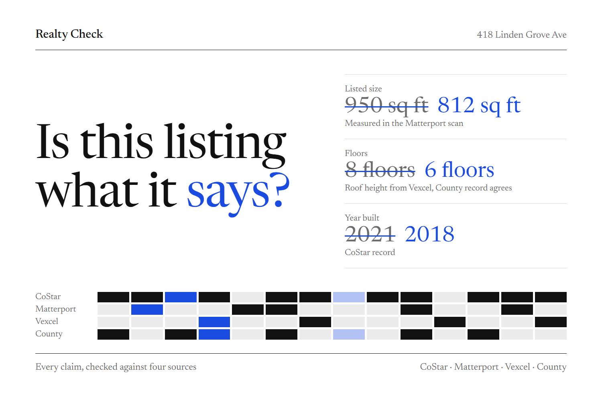
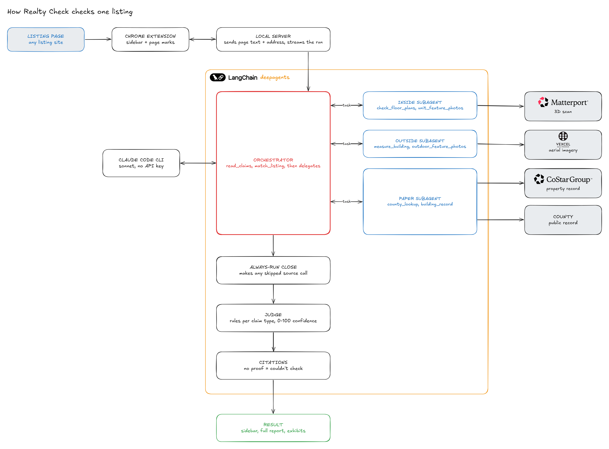

# Realty Check



**Realty Check tells you, on the listing page itself, which of a listing's claims the building's own records back up and which they don't.**

Built at HackPrinceton Fall 2026 (Nov 13–15).

## Elevator pitch

A listing is an advertisement, and nobody checks it. Realty Check is a Chrome extension that reads the listing you are
looking at, pulls out every checkable claim (size, bedrooms, floors, year built, amenities) and has an AI agent test
each one against four independent sources: the CoStar property record, the Matterport 3D scan, Vexcel aerial imagery
and the county record. In about a minute you see what matches, what doesn't, how sure we are, and the exhibit behind
every answer.

## The simple explanation

You open an apartment listing. It says "950 sq ft, 8 floors, built 2021".

1. You click **Check this listing** in the sidebar.
2. The agent reads the page and lists the claims it can test.
3. Three helpers go and look: one walks the 3D scan of the inside, one measures the building from the air, one reads
   the property and county records.
4. A fixed set of rules compares what the listing says with what the sources found.
5. The sidebar strikes through each claim that doesn't hold and shows the value the sources found, with a confidence
   score and a link to the proof. A full report adds questions to ask before you tour, and facts the listing left out.

The wording stays careful on purpose. A source having nothing on a claim is never counted against the listing, and a
difference is reported as a difference, not as an accusation.

## Architecture



| Part | Where | What it does |
|---|---|---|
| Chrome extension (Manifest V3) | `extension/` | Reads the listing page, opens the sidebar, relays the live run, marks claims on the page |
| Local server (FastAPI) | `server/` | `POST /check` starts a run and streams its events; also serves the full report, the 3D walkthrough and the exhibit library |
| Orchestrator (deepagents) | `harness/graph/` | Reads the claims, matches the address to a building, decides which helpers are needed, hands out the work |
| Inside helper | `harness/graph/`, `tools/scan/` | Matterport scan: room counts, measured floor area, in-unit features |
| Outside helper | `harness/graph/`, `tools/aerial/` | Vexcel aerial: roof height (and so floors), pools, courts and other outdoor features |
| Paper helper | `harness/graph/`, `tools/` | CoStar record and county record: floors, year built, unit count, floor plans, amenities |
| Judge | `harness/graph/judge.py`, `trust.py` | Plain code, no model: tolerances per claim type, a 0–100 confidence score, a citation for every verdict |

The model proposes and gathers; it never decides a verdict. Every verdict comes from the rule code and must carry a
citation, otherwise it is downgraded to "couldn't check". The agent runs on the Claude Code CLI login, so the
harness holds no model API key.

### Inside the harness

The harness is the product. One run goes like this:

1. **Snapshot in.** The extension sends the page text and address. The run has a hard limit of 96 seconds.
2. **Orchestrator, turn 1.** `read_claims` pulls claims from the page (patterns, the page's structured data and one
   model call; up to 40 claims of 11 kinds, ranges included). `match_listing` ties the address to one building. The
   harness then works out which helpers this listing actually needs.
3. **Orchestrator, turn 2.** It delegates through deepagents' `task` tool to three subagents, in parallel. Each has two
   tools and reports back after one round:
   - `inside`: `check_floor_plans`, `unit_feature_photos` (Matterport scan)
   - `outside`: `measure_building`, `outdoor_feature_photos` (Vexcel aerial)
   - `paper`: `county_lookup`, `building_record` (County record, CoStar record)
4. **Orchestrator, turn 3.** `judge_claims`, then `fill_in` for facts the listing left out. The judge refuses once if
   a helper that was needed was never asked.
5. **Always-run close.** Plain code makes any source call the agent skipped, so a slow or cut-off agent still ends in
   a full answer.
6. **Judge.** Rules per claim type: counts must match exactly, written sizes within 5%, a scan-measured area from 12%
   smaller to 5% larger. Each difference gets a 0–100 confidence from how big the gap is, how well the source suits
   that claim, and whether other sources agree.
7. **Citations.** Every verdict must point at its proof. One that cannot is downgraded to "couldn't check".

Guard rails in code: the model runs as a fresh Claude Code CLI process per call with every API key stripped from its
environment; it is capped at 14 calls and a 75-second budget; a missing feature is never a mismatch; a floor count
read from a photo never decides; people's names are never shown.

Diagram source: `docs/img/architecture.excalidraw` (built by `docs/img/architecture.py`).

## Tracks

### CoStar Group — "Inside and Out: AI for the Built World"

- **Uses all three data layers together, plus a fourth.** CoStar property records, Matterport scans and Vexcel
  aerial imagery are each read by their own helper, and the county record is added as an outside reference. The
  result only exists because the layers are combined: a floor count is settled by roof height measured from the air
  and confirmed against the records; a listed size is settled by the area measured inside the scan.
- **Agentic, not a chat wrapper.** An orchestrator plans the run, chooses which helpers a given listing needs,
  sends them out in parallel and hands their findings to the judge. There is no chat box anywhere in the product.
- **A real person with a real problem.** Someone about to rent or buy, deciding from a listing they cannot verify.
- **Spatial and visual, not only text.** Exhibits include the live 3D walkthrough opened at the relevant spot,
  aerial images, and a roof-height drawing.

### HackPrinceton main track — Business and Enterprise

Listing accuracy is a business problem before it is a consumer one. Listing platforms, brokerages and property
managers carry the cost of wrong listings: wasted tours, disputes, lost trust. Realty Check is an audit tool for
that: it turns a listing into a table of claims, sources, verdicts and confidence, with the evidence attached, which
is the analytics and compliance view a listings team would use to check inventory before it goes live. The
extension is the consumer face of the same engine.

### LangChain — Best use of deepagents

- The harness is built on `create_deep_agent`: one orchestrator and three named subagents (`inside`, `outside`,
  `paper`), each with its own tools, called through the `task` tool in parallel.
- We wrote a custom LangChain chat model that drives the Claude Code CLI, so deepagents runs on a subscription login
  with tool calling handled in our own adapter.
- A harness profile switches off what this job does not need (file tools, todo list, general-purpose subagent), and
  middleware caps model calls and ends the run as soon as verdicts exist. A run has a hard time budget, and a
  model-free closing step makes any source call the agent skipped, so every run finishes with a complete answer.
- The agent's reach is deliberately narrow: it gathers evidence, and deterministic code judges it.

### Peri — Forward Deployed Challenge

> **To fill in before submitting** (required by the track): business name, the name and role of the person
> consulted, and one piece of evidence (screenshot, photo, short video or direct quote).

How the project fits: it is complete end to end (page, run, verdicts, report, exhibits), it installs as a browser
extension with no change to anyone's workflow, and it answers a need a listings business has every day: knowing
whether what it publishes is true.

## Run it

Requires Python 3.11+ and Chrome.

```
python -m venv .venv
.venv/Scripts/pip install -e .
set RC_PRIVATE_DIR=<a folder outside this repo>
.venv/Scripts/python -m server          # http://127.0.0.1:8787
```

Then in `chrome://extensions` turn on Developer mode, choose **Load unpacked** and select `extension/`.

- **Without sponsor data:** set `RC_FAKE=1` before starting the server for a canned run, or with no server at all
  choose **Use sample result** in the sidebar.
- **With sponsor data:** `RC_PRIVATE_DIR` must hold the private dataset and keys. They are not in this repo.
- **Demo listing pages:** see `docs/demo_site/README.md`.
- **Tests:** `.venv/Scripts/python -m pytest`

More detail: `docs/CONTRACT.md` (flow and data shapes) and `docs/DECISIONS.md`.

## Built with

Python, [deepagents](https://github.com/langchain-ai/deepagents) and LangChain, Claude (through the Claude Code
CLI), FastAPI, uvicorn, httpx, requests, Pillow, NumPy, tifffile, pyzipper, python-dotenv, pytest, Playwright (tests),
the Matterport SDK and API, the Vexcel API, CoStar property data, county open data, the Chrome Extensions API
(Manifest V3), the Newsreader typeface, Excalidraw (diagram).

## Team

- Rohan Gore
- Raunak Choudhary

## Thumbnail

`docs/img/thumbnail.png` (1500×1000) is drawn from `docs/img/thumbnail.html`, in the product's own design: Newsreader,
black on white, one blue. It uses an invented listing. To change it, edit the HTML and take a 1500×1000 screenshot.
