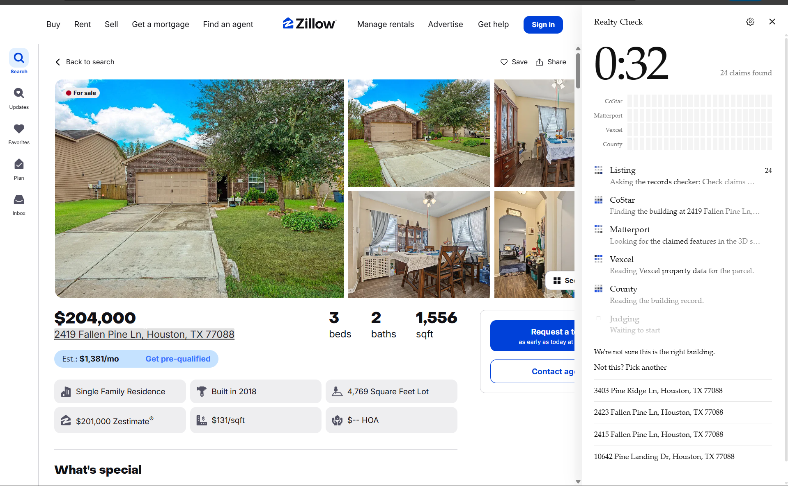
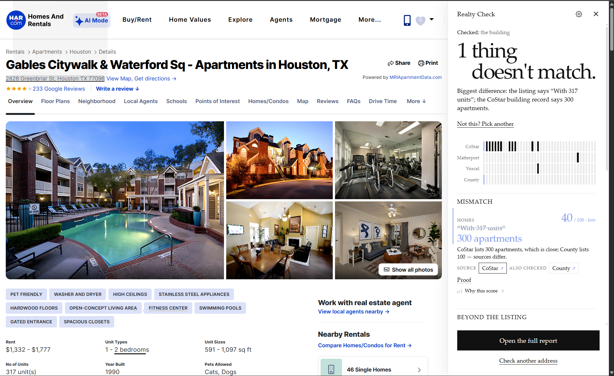
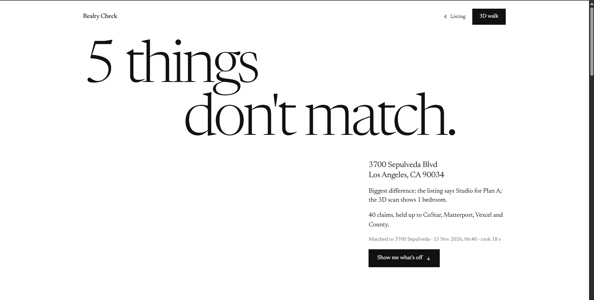
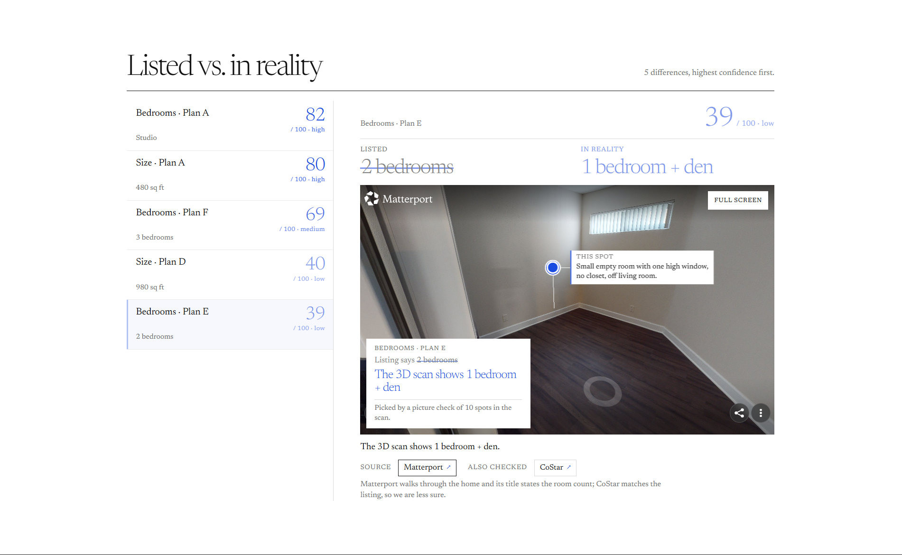
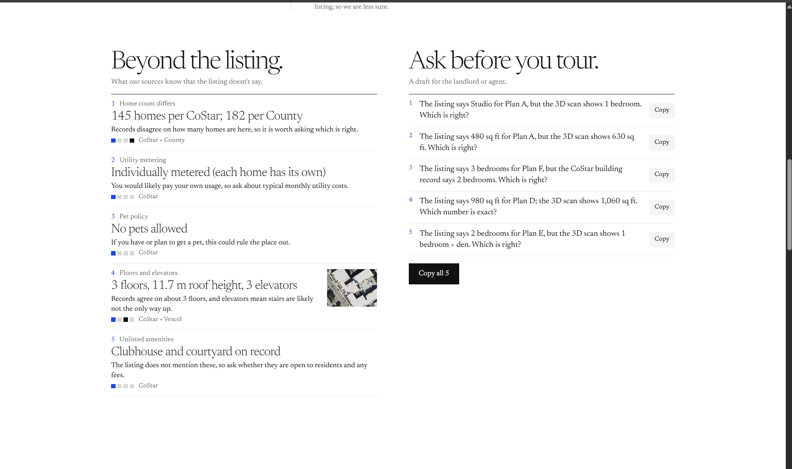
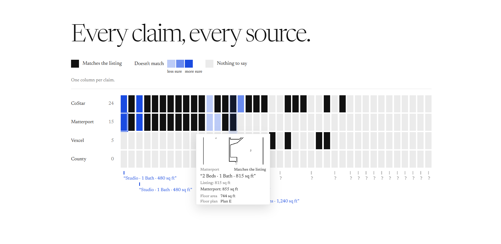
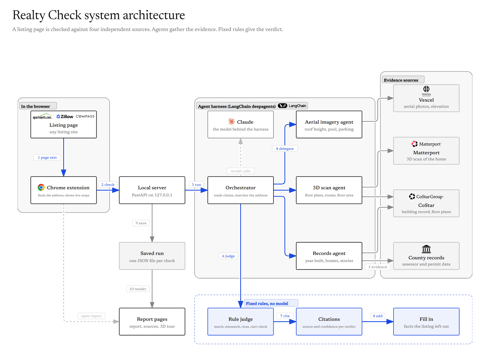

# Realty Check

**Realty Check is a custom agent harness that fact-checks a property listing.** The person selling writes the listing,
and nobody checks it. Click the address on any listing page, whether it is a rental, a home for sale, a short stay or
an office. About a minute later you see each claim that does not match, the value on record, a confidence score and
the source that decided it. The record comes from four sources: CoStar, the Matterport 3D scan, Vexcel aerial imagery
and the county.

<table>
  <tr>
    <td width="50%" align="center" valign="top"><br><sub>Live check on a Zillow listing. The side panel streams each step of the run.</sub></td>
    <td width="50%" align="center" valign="top"><br><sub>Side panel with the final verdict, the mismatch, a confidence score and citations.</sub></td>
  </tr>
  <tr>
    <td width="50%" align="center" valign="top"><br><sub>Full report, landing page.</sub></td>
    <td width="50%" align="center" valign="top"><br><sub>Listed vs. in reality. The 3D scan opens at the spot that settles the claim.</sub></td>
  </tr>
  <tr>
    <td width="50%" align="center" valign="top"><br><sub>What the listing left out, and questions to ask before you commit.</sub></td>
    <td width="50%" align="center" valign="top"><br><sub>Claim by claim, every source compared.</sub></td>
  </tr>
</table>

Built at HackPrinceton Fall 2026 (Nov 13–15).

## Architecture



1. **Listing page to extension.** The Chrome extension (`extension/`) reads the page text and the address.
2. **Extension to local server.** `POST /check` on the FastAPI server (`server/`) starts a run and streams every step
   back to the side panel.
3. **The harness runs** (`harness/graph/`, built on LangChain deepagents).
   - One orchestrator reads up to 40 claims of 11 kinds and matches the address to one building.
   - It delegates to three agents in parallel: 3D scan (Matterport), aerial imagery (Vexcel), records (CoStar and
     county).
   - Agents can call our six tools and nothing else. File, shell and to-do tools are switched off.
   - Hard limits: 14 model calls and 96 seconds per run.
   - Plain code makes any source call the agents skipped, so a cut-off run still ends in a full answer.
4. **Fixed rules give the verdict.** The model gathers evidence and never judges. Counts must match exactly, written
   sizes within 5%. A verdict with no citation becomes "couldn't check".
5. **Saved run to report.** The side panel shows the mismatches. The full report adds the 3D scan at the spot that
   settles the claim, facts the listing left out and questions to ask.

## Tracks

### CoStar Group — "Inside and Out: AI for the Built World"

- **Uses all three data layers together, plus a fourth.** CoStar property records, Matterport scans and Vexcel
  aerial imagery are each read by their own helper, and the county record is added as an outside reference. The
  result only exists because the layers are combined: a floor count is settled by roof height measured from the air
  and confirmed against the records; a listed size is settled by the area measured inside the scan.
- **Agentic, not a chat wrapper.** An orchestrator plans the run, chooses which helpers a given listing needs,
  sends them out in parallel and hands their findings to the judge. There is no chat box anywhere in the product.
- **A real person with a real problem.** Someone about to rent or buy, deciding from a listing they cannot verify.
- **Spatial and visual, not only text.** Exhibits include the live 3D walkthrough opened at the relevant spot,
  aerial images, and a roof-height drawing.

### HackPrinceton main track — Business and Enterprise

Listing accuracy is a business problem before it is a consumer one. Listing platforms, brokerages and property
managers carry the cost of wrong listings: wasted tours, disputes, lost trust. Realty Check is an audit tool for
that: it turns a listing into a table of claims, sources, verdicts and confidence, with the evidence attached, which
is the analytics and compliance view a listings team would use to check inventory before it goes live. The
extension is the consumer face of the same engine.

### LangChain — Best use of deepagents

- The harness is built on `create_deep_agent`: one orchestrator and three named subagents (`inside`, `outside`,
  `paper`), each with its own tools, called through the `task` tool in parallel.
- We wrote a custom LangChain chat model that drives the Claude Code CLI, so deepagents runs on a subscription login
  with tool calling handled in our own adapter.
- A harness profile switches off what this job does not need (file tools, todo list, general-purpose subagent), and
  middleware caps model calls and ends the run as soon as verdicts exist. A run has a hard time budget, and a
  model-free closing step makes any source call the agent skipped, so every run finishes with a complete answer.
- The agent's reach is deliberately narrow: it gathers evidence, and deterministic code judges it.

### Peri — Forward Deployed Challenge

The person we built this for is you. If you have ever booked a stay, rented an apartment or toured a home, you have
decided from a listing you could not check, and you have opened a door to something smaller than the photos.

Realty Check is deployed where that decision happens. It installs as a browser extension, works on the listing page
you already have open, and needs no change to how you search. One click on the address, about a minute, and you see
what the records say before you pay. It runs end to end today: page, run, verdicts, report and proof.

## Run it

Requires Python 3.11+ and Chrome.

```
python -m venv .venv
.venv/Scripts/pip install -e .
set RC_PRIVATE_DIR=<a folder outside this repo>
.venv/Scripts/python -m server          # http://127.0.0.1:8787
```

Then in `chrome://extensions` turn on Developer mode, choose **Load unpacked** and select `extension/`.

- **Without sponsor data:** set `RC_FAKE=1` before starting the server for a canned run, or with no server at all
  choose **Use sample result** in the sidebar.
- **With sponsor data:** `RC_PRIVATE_DIR` must hold the private dataset and keys. They are not in this repo.
- **Demo listing pages:** see `docs/demo_site/README.md`.
- **Tests:** `.venv/Scripts/python -m pytest`

More detail: `docs/CONTRACT.md` (flow and data shapes) and `docs/DECISIONS.md`.

## Built with

Python, [deepagents](https://github.com/langchain-ai/deepagents) and LangChain, Claude (through the Claude Code
CLI), FastAPI, uvicorn, httpx, requests, Pillow, NumPy, tifffile, pyzipper, python-dotenv, pytest, Playwright (tests),
the Matterport SDK and API, the Vexcel API, CoStar property data, county open data, the Chrome Extensions API
(Manifest V3), the Newsreader typeface, Excalidraw (diagram).

## Team

- Rohan Gore
- Raunak Choudhary
