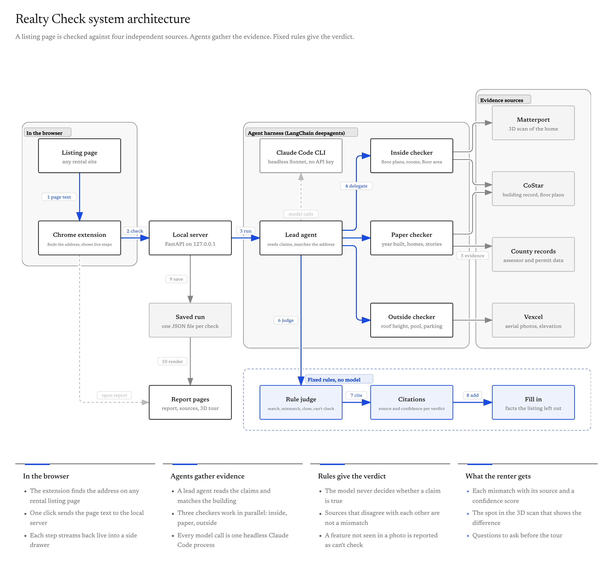

# System architecture



Open `system-architecture.html` in a browser for the interactive version: hover a box to see what it connects to.

## How one check runs

1. The extension finds the address on a rental listing page and reads the page text.
2. One click sends the page to the local server (`POST /check`).
3. The server starts a run in the agent harness and streams every step back to the drawer.
4. A lead agent reads the claims, matches the address to a building, and hands work to three checkers.
5. The checkers gather evidence: inside (3D scan, floor plans), paper (county and building records), outside (aerial photos, elevation).
6. A rule judge gives each claim one of four verdicts: match, mismatch, close, or can't check. No model is involved.
7. Every verdict gets its sources and, for a mismatch, a confidence score.
8. Facts the listing left out are added.
9. The server saves the run as one JSON file.
10. The report, the source library and the 3D tour are rendered from that file.

## Files

| File | What it is |
|---|---|
| `system-architecture.json` | The diagram source: boxes, groups and arrows |
| `theme.css` | The Realty Check look (type, ink, one blue) |
| `render.py` | Rebuilds the HTML and the PNG |
| `system-architecture.html` | Interactive diagram |
| `system-architecture.png` | Image for the README and slides |

## Rebuild

The drawing is done by [archify](https://github.com/tt-a1i/archify). Clone it, then from the repo root:

```
python docs/architecture/render.py /path/to/archify/bin/archify.mjs
```

The PNG step needs Playwright with Chromium. Without it, only the HTML is written.
